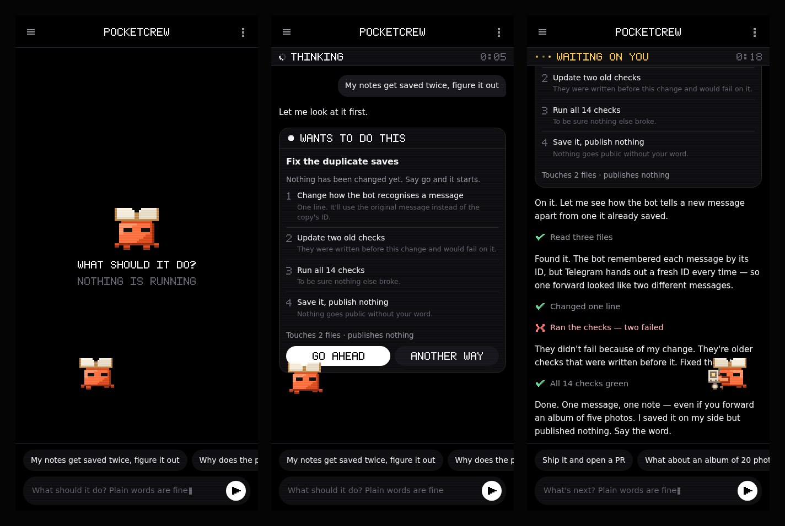

# PocketCode

Run a real coding agent from your phone. PocketCode wraps **Claude Code** in a small
daemon and serves a one-screen interface you open in the browser — no terminal, no logs,
plain language. A pixel pet lives on the screen while the agent works.



## Install

In Termux:

```sh
npm install -g github:alishergiyasov100-boop/pocketcode
pocketcode
```

The first run sets everything up: it checks node, installs Claude Code if it is missing,
installs `termux-api` so the agent survives the screen turning off, asks which folder to
work in and which engine to use, then starts.

Open **http://127.0.0.1:4848** and add it to your home screen — it runs standalone.

## Commands

| | |
|---|---|
| `pocketcode` | set up if needed, then run |
| `pocketcode status` | is it running, on what, how much it has spent |
| `pocketcode setup` | change project, gateway or model |
| `pocketcode restart` | stop and start again |
| `pocketcode boot` | start it automatically when the phone boots |
| `pocketcode update` | pull the latest build and restart |
| `pocketcode search <key>` | let it search the web (`off` to stop) |
| `pocketcode doctor` | show what is missing |
| `pocketcode widget` | home-screen shortcut via Termux:Widget |
| `pocketcode stop` | stop the daemon |

`status` is the one to reach for when you are not sure anything is alive:

```
  running       pid 17609 · http://127.0.0.1:4848
  project       noteclip  /home/you/projects/noteclip
  engine        claude-sonnet-5  via your gateway
  gateway       answering in 310ms
  agent         idle
  app open      1 connected
  session       $0.31  48K tokens · 6 turns · 7m
```

Running `pocketcode` while it is already up says so instead of failing.

It does not need the terminal. `pocketcode` detaches a small supervisor, waits until the
engine answers, prints the status and hands the prompt back — you can close Termux. If the
engine dies, the supervisor brings it back within a few seconds, backing off if it keeps
failing. `pocketcode boot` writes a Termux:Boot hook so it is up after a reboot without you
touching anything.

## Engines

By default it uses whatever your `claude` login uses. You can point it at any
Anthropic-compatible endpoint instead — your own gateway, a proxy, anything that answers
`POST /v1/messages`:

```json
{
  "baseUrl": "https://your-gateway.example",
  "token": "your-key",
  "model": "claude-sonnet-5"
}
```

Config lives in `~/.pocketcode/config.json`.

## Web search

The agent's built-in search goes through Anthropic's own API, so behind a
gateway it is simply not there. PocketCode ships its own instead: a small
MCP server (`src/search.js`) with two tools — `web_search` and `web_read`,
the second one opens a page and hands back plain text.

It needs a search key. A free one with 2500 searches comes from serper.dev,
takes a minute and no card. Paste it in Settings → Web search on the phone,
or run `pocketcode search <key>`. Without a key the tools are not loaded at
all, and nothing else changes.

While search is on the agent is given that MCP server and no other, so what
it can reach is exactly what PocketCode ships.

## When requests do not go through

Usually it is not the gateway, it is the agent binary. A half-finished
`npm i -g @anthropic-ai/claude-code` leaves a few-hundred-byte stub whose
native binary never downloaded. If that stub sits first in PATH, every
request dies with `Exec format error` and the app looks silent.

PocketCode no longer trusts PATH: it tries every `claude` it can find,
runs `--version` on each, and uses the first that actually answers,
remembering it in the config. `pocketcode status` names the binary when
it had to skip a broken one.

## Budget

Your gateway does not stop you, and its replies report zero tokens, so the
usage strip had nothing true to say and hid itself — which looked broken.

PocketCode keeps its own books now. After every turn it reads the key's
counter on the gateway (`/v1/me`), takes the difference since last time and
writes it to `~/.pocketcode/ledger.jsonl` with a timestamp. Session, today
and this week are summed from that file, so the numbers are the gateway's
own billing, not a guess. Turns are counted directly and are exact.

Set a cap in Settings -> Budget: turns, tokens, dollars, per day or week.
The bar then means something, and at the line sending pauses until the
window rolls over instead of quietly spending more.

## Long commands

Claude's Bash tool kills anything still running at two minutes. On a phone
that is barely enough for `npm install`, and from the app it reads as "the
agent cannot do long jobs" — the command comes back as exit code 143,
`Command timed out after 2m 0s`.

PocketCode raises it to ten minutes and lets the agent ask for up to
twenty. Change it in Settings -> Command timeout: two minutes, ten, thirty
or an hour.

## While it works

Five things the terminal gives you that a phone needs more, not less:

- **Stop.** The send button becomes a stop button while it is working. One
  tap, no hunting for a key combination.
- **Its plan.** When the agent keeps a checklist, the checklist is on
  screen and updates itself — done items struck through, the current one
  spinning, "3 of 7" at the top.
- **The whole output.** Tool output is trimmed to a couple of lines, with
  "show all 40 lines" under it when there is more.
- **A nudge when it is done.** If you left the app, a notification says
  what it finished with. Turn it off in Settings.
- **Undo.** Before every message PocketCode takes a git snapshot of the
  project — `git stash create`, which touches neither your history nor
  your working tree. "Undo last turn" in the + menu puts the files back,
  including work you had not committed. Files it newly created stay.

## How it works

```
browser  ──websocket──►  daemon  ──stream-json──►  claude -p
   ▲                        │                          │
   └── plain-language ──────┴──── normalised events ───┘
```

The daemon keeps **one long-lived** `claude` process per session using
`--input-format stream-json --output-format stream-json`, so a conversation is many turns
in one process rather than a cold start per message. Raw events are translated into
something a human reads: `Read src/store.py` becomes *Read store.py*, a `pytest` command
becomes *Ran the tests*.

No runtime dependencies. The WebSocket server is ~130 lines of plain Node.

## Status

Early prototype. The interface is real and the bridge drives a real agent on a real
repository. Rough edges are expected.
